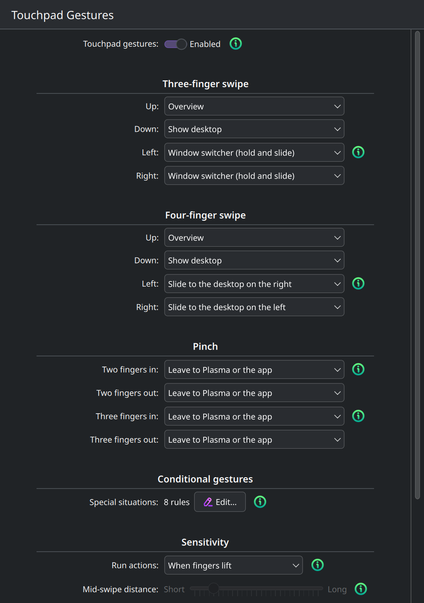

# kwin-winlike-gestures

Windows-style touchpad gestures for KDE Plasma 6 on Wayland, configurable per gesture.

It comes in two parts:

* **A KWin plugin** (a compiled C++ plugin, not a KWin script). It runs inside the
  compositor, sees touchpad gestures *before* KWin's own gesture bindings do, and maps
  them to actions you choose. Because it takes gestures over completely, Plasma's
  built-in gestures can't fire alongside it.
* **A System Settings page**, *Mouse & Touchpad → Touchpad Gestures*, where you turn the
  plugin on or off and pick what each gesture does. No config file editing needed.

Plasma ships a few built-in touchpad gestures, but you can't change them. The defaults
here copy a Windows precision touchpad.

Built and tested against **KWin / Plasma 6.8.1** on openSUSE Tumbleweed.

---

## Default gestures

| Gesture | Action |
|---|---|
| 3-finger swipe up | Overview (like Windows Task View). **If the desktop is shown:** bring the windows back |
| 3-finger swipe down | Show Desktop. **If Overview is open:** close Overview. **If the desktop grid is open:** open the highlighted window |
| 3-finger swipe left / right | **Alt+Tab switcher.** Opens and stays open while your fingers are down; keep sliding left/right/up/down to move the selection (like the arrow keys); lift to switch. A quick flick jumps to the previous window. **If the desktop grid is open:** move the grid's highlight one window left/right instead (it presses the arrow key) |
| 4-finger swipe up | Same as 3-finger up (including the desktop-shown rule) |
| 4-finger swipe down | Same as 3-finger down (including the Overview rule). **If the desktop grid is open:** close the grid |
| 4-finger swipe left / right | **Slide between virtual desktops**, using Plasma's own animation, which follows your fingers. The desktop moves with them, so swiping left brings in the desktop on the right. Swipe back before lifting to stay where you are. |
| 2-finger scroll, pinch-zoom, 2-finger tap | Untouched: handled by libinput and apps, already like Windows |

Every binding can be changed in **System Settings → Mouse & Touchpad → Touchpad
Gestures** (see [Settings page](#settings-page)) or in the config file (see
[Configuration](#configuration)).



---

## Install

### openSUSE Tumbleweed and Slowroll (recommended)

Ready-made packages come from the
[openSUSE Build Service](https://build.opensuse.org/package/show/home:MetuMortis/kwin-winlike-gestures).
They're rebuilt automatically whenever openSUSE updates KWin, so the plugin always
matches your Plasma version.

**1. Add the repository and install:**

```sh
sudo zypper addrepo https://download.opensuse.org/repositories/home:MetuMortis/openSUSE_Tumbleweed/home:MetuMortis.repo
sudo zypper refresh
sudo zypper in kwin-winlike-gestures
```

On **Slowroll**, use `openSUSE_Slowroll` instead of `openSUSE_Tumbleweed` in the first
line (both places).

`zypper refresh` asks whether to trust the repository's signing key. Check that it says
**`home:MetuMortis OBS Project`** and answer **`a`** (always), so updates install without
asking again.

**2. Turn it on:** open **System Settings → Mouse & Touchpad → Touchpad Gestures**, switch
on **Touchpad gestures** and press **Apply**. It starts working right away and loads
automatically at every login from then on. The plugin is off after installing so that it
never changes your gestures until you choose to.

**Updates** arrive with your normal system updates (`sudo zypper up`, or Discover).

**To remove it:** switch it off in the settings page first, then
`sudo zypper rm kwin-winlike-gestures`. To also drop the repository:
`sudo zypper removerepo home_MetuMortis`.

### Arch, Fedora, Debian/Ubuntu and other distros (build from source)

There are no ready-made packages for these yet, so you build the plugin yourself. It only
takes a couple of minutes. You need **Plasma 6 on Wayland**.

**1. Install the build dependencies** for your distro. These only add compilers, headers
and build files; nothing on your running desktop changes.

**Arch Linux / Manjaro / EndeavourOS** (Arch doesn't split off dev packages; the `kwin`
package already contains its headers):

```sh
sudo pacman -S --needed base-devel git cmake extra-cmake-modules kwin \
    kcmutils ki18n kconfig kcoreaddons kwindowsystem \
    qt6-base qt6-declarative wayland libepoxy libdrm vulkan-headers
```

**Fedora** (KDE Plasma edition or spin, Fedora 40 or newer):

```sh
sudo dnf install git cmake gcc-c++ extra-cmake-modules kwin-devel \
    kf6-kcmutils-devel kf6-ki18n-devel kf6-kconfig-devel kf6-kcoreaddons-devel \
    kf6-kwindowsystem-devel qt6-qtbase-devel qt6-qtbase-private-devel \
    qt6-qtdeclarative-devel libepoxy-devel libdrm-devel vulkan-loader-devel \
    vulkan-headers wayland-devel
```

**Debian 13 (trixie) or newer / Kubuntu 24.10 or newer / KDE neon:**

```sh
sudo apt install git cmake g++ extra-cmake-modules kwin-dev \
    libkf6kcmutils-dev libkf6i18n-dev libkf6config-dev libkf6coreaddons-dev \
    libkf6windowsystem-dev qt6-base-dev qt6-base-private-dev qt6-declarative-dev \
    libepoxy-dev libdrm-dev libvulkan-dev libwayland-dev
```

Kubuntu 24.04 LTS and Debian 12 ship Plasma 5, which this plugin doesn't support.

**openSUSE** (if you'd rather build than use the package above):

```sh
sudo zypper in git kwin6-devel kf6-extra-cmake-modules kf6-kconfig-devel \
    kf6-kglobalaccel-devel kf6-kcoreaddons-devel kf6-kwindowsystem-devel \
    qt6-base-private-devel qt6-dbus-devel qt6-declarative-devel libinput-devel \
    kf6-kcmutils-devel kf6-ki18n-devel cmake gcc-c++
```

Other distros: install your distro's KWin development package plus the KF6 and Qt 6
development packages for the same libraries as above. If something is missing, CMake
names it when `./install.sh` configures the build.

Only the openSUSE list has been tested. The others come from each distro's KWin
packaging; please open an issue if your distro needs a correction.

**2. Download, build and install** (run as your normal user, **not** with `sudo`; it asks
for your password only for the copy step):

```sh
git clone https://github.com/LiberaTeMetuMortis/kwin-winlike-gestures.git
cd kwin-winlike-gestures
./install.sh
```

When it's done, log out and back in if it tells you to.

**3. Turn it on:** open **System Settings → Mouse & Touchpad → Touchpad Gestures**, switch
on **Touchpad gestures** and press **Apply**.

**After every Plasma update**, update your system (which updates the KWin development
package along with KWin), then run `./install.sh` again from the same folder (`git pull`
first to get the latest version). The plugin has to be built for your exact KWin version;
until you rebuild, KWin refuses the old one and you get Plasma's default gestures back.

**To remove it:** `./uninstall.sh` (see [Uninstall](#uninstall)).

---

## How it works

### Why a KWin plugin

On Wayland the compositor (KWin) owns the input devices. Outside tools like
`libinput-gestures`, `touchegg` or `fusuma` either can't read touchpad gestures at all,
or can't stop KWin's built-in gestures from firing too. The only reliable place to
handle gestures is **inside KWin's input pipeline**. Binary KWin plugins
(`KWin::Plugin`) are loaded into the `kwin_wayland` process and can install an
`InputEventFilter` there.

### The input pipeline

KWin runs every input event through a chain of `InputEventFilter`s, ordered by weight
(`InputFilterOrder` in `kwin/input.h`). Each filter returns `true` to consume the event
(later filters never see it) or `false` to pass it on:

```
libinput ─► … ─► LockScreen ─► ScreenEdge ─► DragAndDrop ─► [WindowSelector: OUR FILTER]
                                                             │
           ◄── consumed if the gesture is ours ──────────────┘
                                                             ▼
                          TabBox ─► GlobalShortcut (KWin's built-in gestures) ─► … ─► Forward (apps)
```

* We come **after LockScreen**, so nothing fires on the lock screen.
* We come **before GlobalShortcut**, where KWin's built-in touchpad gestures live, so
  we can take a gesture away from KWin.
* We come **before TabBox**, so we keep receiving swipe updates while the Alt+Tab
  switcher we opened is on screen.

### Taking ownership of a gesture

When libinput reports a swipe start, we only know the finger count, not the direction.
`GestureFilter` puts each gesture in one of three modes:

| Mode | When | Behaviour |
|---|---|---|
| **Owned** | every direction for this finger count is bound to one of our actions | Consume from the first event. KWin and apps never see the gesture. |
| **Watching** | only some directions are ours | Pass events through until the direction locks. If it's ours, send a `swipeGestureCancelled` down the rest of the chain (via `input()->processFilters`) and switch to Owned. Otherwise switch to Ignored. |
| **Ignored** | nothing bound for this finger count | Pass everything through. |

With the defaults, both 3- and 4-finger swipes are fully bound, so they're always
**Owned**. Watching mode only applies if you set some directions to `passthrough`.
Cancelling KWin's gesture partway through isn't fully reliable (KWin's animation may
already have started), so binding all four directions of a finger count gives the
cleanest result.

### Handing a swipe to Plasma's own gestures

KWin's built-in touchpad gestures follow the fingers: the desktop slide moves with them,
Overview grows in, and lifting halfway finishes or snaps back. A direction bound to
`plasma:<fingers><direction>` (e.g. `plasma:4Left`) borrows one of those:

1. The plugin owns the gesture as usual, so KWin sees nothing while the direction is
   unknown. (This is why it works where `passthrough` for some directions doesn't.)
2. When the direction locks, the plugin replays the swipe down the input chain
   (`input()->processFilters`, the same call used for cancel events): a begin event
   with the target's finger count, then one update holding all the movement so far.
   Our own filter lets these through, and KWin's GlobalShortcut filter starts its
   gesture as if the fingers had been there from the start.
3. Every later update, the end and any cancel are passed on the same way.

The swipe can be handed over as a different gesture. `turnDelta()` rotates the
movement so that travel in the real direction becomes travel in the target's: with
`Swipe4Up=plasma:4Left`, moving up counts as moving left, and moving back down as moving
right, so stopping or reversing still snaps back. The finger count can change too:
KWin's vertical desktop slide only exists for 3 fingers, so `plasma:3Up` serves a
4-finger swipe as well.

KWin 6.8 has these touchpad gestures (content follows the fingers):

| Target | KWin gesture |
|---|---|
| `plasma:4Left` / `plasma:3Left` | Slide to the desktop on the right |
| `plasma:4Right` / `plasma:3Right` | Slide to the desktop on the left |
| `plasma:3Up` | Slide to the desktop below |
| `plasma:3Down` | Slide to the desktop above |
| `plasma:4Up` | Overview; again from Overview for the desktop grid |
| `plasma:4Down` | Desktop grid; from Overview or the grid, closes it |

A slide only does something if there's a desktop on that side: with desktops in one
row, *below* and *above* do nothing; with one desktop per row, *left* and *right* do
nothing. KWin moves one step at a time, so with three desktops in two rows (`[1][2]` over
`[3]`) bind left/right to the sideways slides and up/down to the vertical ones.

### Direction recognition

`SwipeRecognizer` adds up libinput deltas (+x right, +y down). Once the total movement
passes `Threshold` (default 30 units), it locks onto the dominant axis. The lock never
flips during a gesture. `PinchRecognizer` does the same for pinch scale (In below
`1 - PinchThreshold`, Out above `1 + PinchThreshold`).

Discrete actions (shortcuts, commands) run when the fingers **lift** by default, and only
if a direction locked. With `TriggerTiming=midswipe` they run **mid-swipe** instead, as
soon as the fingers have travelled `TriggerDistance` (default 80 units) along the locked
direction, so Overview opens while you're still swiping. A swipe that never gets that
far does nothing. Pinches have no travel distance, so in mid-swipe mode they run as soon
as the pinch direction locks. `ActionTrigger` makes sure an action fires at most once per
gesture, unless **swipe back to undo** is on (`ReverseUndo=true`, mid-swipe only): then
moving back the other way by `TriggerDistance` from the furthest point, without lifting,
runs the **opposite direction's** binding with the desktop state as it is *now*. After
3 fingers up opened Overview, swiping back down runs "3 fingers down while Overview is
open" (close Overview); after 4 fingers right (next desktop), swiping back left runs
"previous desktop". Moving forward again re-runs the original, so you can go back and
forth before lifting. Swiping back only works when both the action that ran and the
opposite direction's are a shortcut or command. A pressed key can't be taken back, and
the window switcher, *Do nothing* and *Leave to Plasma* run nothing to undo with: then
swiping back does nothing and the gesture stops there. The plugin can't tell whether an
action had an effect: on the last desktop (without wrap-around), "next desktop" does
nothing, but swiping back still runs "previous desktop". Swipes only; pinches fire once. A cancelled gesture does nothing. The window switcher follows the fingers live
in either mode.

### Running actions

* **`shortcut:`** sends `invokeShortcut` to `org.kde.kglobalaccel`. On Plasma 6, the
  kglobalaccel service **runs inside `kwin_wayland` itself**, so a blocking D-Bus call
  from the plugin would make KWin wait on itself forever. The plugin only uses
  fire-and-forget `QDBusConnection::send()`.
* **`command:`** runs `/bin/sh -c <command>` detached with `QProcess::startDetached`.
* **`plasma:`** is driven live by `GestureFilter`, see
  [Handing a swipe to Plasma's own gestures](#handing-a-swipe-to-plasmas-own-gestures).

### The live Alt+Tab switcher

KWin's TabBox (the Alt+Tab switcher) stays open as long as Alt is held. The plugin
recreates that with key events injected through KWin's own keyboard pipeline
(`input()->keyboard()->processKey`):

1. When the direction locks (3 fingers, horizontal): **Alt down, Tab tap**. The switcher
   opens with the next window selected.
2. While fingers move: `SwitcherNavigator` turns travel into steps, one per
   `SwitcherStep` units sideways (default 100) and `SwitcherStepVertical` up/down
   (default 60, since touchpads are wider than tall). Horizontal steps tap **Left/Right**,
   vertical steps tap **Up/Down**, exactly the arrow keys TabBox uses to move the
   selection (Up/Down move between rows in grid layouts). When one axis steps, the other
   axis's partial travel is dropped, so the drift of a sideways slide never adds up to
   an accidental up/down step.
3. Fingers lift: **Alt up**, and TabBox switches to the selected window.
4. Gesture cancelled: **Esc tap, Alt up**. The switcher closes without switching.

The filter's destructor releases Alt if the plugin is unloaded mid-gesture, so Alt
can't get stuck down.

### Config reload

The plugin follows KDE's standard pattern instead of polling or watching files:

* **Automatic:** a `KConfigWatcher` listens for change notifications. Anything that
  writes the config with `KConfig::Notify` (a System Settings page, or
  `kwriteconfig6 --notify`) broadcasts the change over D-Bus. The watcher reparses the
  file and the plugin reloads. Nothing else wakes the plugin up.
* **Manual:** after editing the file by hand, run KWin's own "reload settings" command:

  ```sh
  qdbus6 org.kde.KWin /KWin reconfigure
  ```

  This emits `Workspace::configChanged`, and the plugin rereads its file.

The new bindings apply to the next gesture.

### State-dependent bindings

When a gesture starts, the plugin takes a snapshot of three desktop states:

* **Desktop grid open:** the `overview` effect is active and its
  `gridPartialActivationFactor` (or, mid overview-to-grid gesture,
  `transitionPartialActivationFactor`) is past 0.5. The grid is a mode of KWin's
  Overview effect, so this is read from the effect's properties.
* **Overview open:** `effects->isEffectActive("overview")`, and the grid isn't
* **Desktop shown:** `workspace()->showingDesktop()`

A binding with a state suffix (`Swipe3Down.Overview`, `Swipe3Down.Grid`,
`Swipe3Up.Desktop`, any gesture including pinches) is a conditional rule: it wins over
the plain one while that state holds. `inherit` on a state key means "no rule here" (the
settings page writes it when you delete a built-in rule). Only the topmost
state's rules apply (grid, then Overview, then the shown desktop): without one, the
plain key is used, never another state's rule. So with the grid open, a missing `.Grid`
rule falls back to the plain key, not to `.Overview`.
That snapshot is used for the gesture's first action, so the state changing
halfway through (e.g. Overview opening) doesn't switch actions mid-swipe; only a swipe
back to undo looks at the state again.

---

## Code architecture

```
kde-gestures/
├── CMakeLists.txt            build: core lib, plugin module, tests, safe plugin install,
│                             build/installed-files.txt (paths for the scripts)
├── install.sh / uninstall.sh build+test+install / remove, run as your normal user
├── release.sh                ./release.sh X.Y.Z: changelog, tag, push (CI + OBS do the rest)
├── packaging/                OBS spec, .changes (changelog) and _service
├── kwin_winlike_gestures.categories  debug-log switch for KDebugSettings
├── src/
│   ├── main.cpp              WinLikeGesturesFactory: the KWin::PluginFactory entry point
│   ├── metadata.json         plugin metadata (EnabledByDefault: false)
│   ├── winlikeplugin.h/.cpp  WinLikeGestures (KWin::Plugin): owns config + filter, installs
│   │                         the filter, reloads config via KConfigWatcher / KWin reconfigure
│   ├── gesturefilter.h/.cpp  GestureFilter (KWin::InputEventFilter): Owned/Watching/Ignored
│   │                         logic, desktop-state snapshot, cancel injection, live switcher,
│   │                         handing swipes to KWin's own gestures
│   ├── actionrunner.h/.cpp   runAction(): non-blocking kglobalaccel calls and commands
│   ├── gestureconfig.h/.cpp  Action parsing, built-in defaults, overrides, state-specific
│   │                         bindings, coverage queries
│   ├── recognizer.h/.cpp     SwipeRecognizer, PinchRecognizer, SwitcherStepper,
│   │                         SwitcherNavigator, ActionTrigger, turnDelta
│   └── logging.h             WINLIKE logging category (kwin_winlike_gestures)
├── kcm/                      System Settings page (separate .so, runs in systemsettings)
│   ├── CMakeLists.txt        kcmutils_add_qml_kcm; optional via -DBUILD_KCM=OFF
│   ├── kcm_winlikegestures.json  page metadata: name, icon, category "pointing-devices"
│   ├── kcm_winlikegestures.h/.cpp  KQuickConfigModule: load/save/defaults, enable switch,
│   │                         KWin shortcut list; reuses GestureConfig::defaults()
│   └── ui/
│       ├── main.qml          the form: sections per finger count, states, pinch, sliders
│       └── GestureRow.qml    one binding: action dropdown + shortcut picker / command field
└── tests/
    ├── test_recognizer.cpp   direction lock, threshold, progress, reset, pinch, stepping,
    │                         turning a swipe into another direction
    └── test_gestureconfig.cpp parsing, round-trip, defaults, overrides, states, bad values
```

The code is split in two layers on purpose:

* **`winlike_core`** (static lib: `recognizer`, `gestureconfig`) depends only on QtCore.
  All the decision logic lives here and is unit-tested without KWin.
* **`kcm_winlikegestures.so`** (settings page) links `winlike_core` too, so the page
  always shows the same defaults the plugin uses.
* **`winlikegestures.so`** (plugin module) is the thin layer that touches KWin's
  **internal, unstable** API: the input filter, key injection and plugin glue. Keeping it
  small keeps the work after each Plasma update small.

---

## Building

### Dependencies

The per-distro package lists are in [Install](#arch-fedora-debianubuntu-and-other-distros-build-from-source).

Notes:

* Qt Quick (`qt6-declarative`) and the epoxy, DRM, Vulkan and Wayland headers are needed
  because **KWin's own CMake package** looks for them, even though this plugin doesn't use
  them directly. Some distros' KWin dev packages don't pull them in.
* **The KWin development files must match your installed KWin version exactly.** The plugin
  interface ID contains the version (`org.kde.kwin.PluginFactoryInterface6.8.1`), and KWin
  refuses plugins built for another version. Install them from the same repositories as
  your KWin and rebuild after every Plasma update.

### Build and test

```sh
cmake -S . -B build -DCMAKE_INSTALL_PREFIX=/usr -DCMAKE_BUILD_TYPE=RelWithDebInfo
cmake --build build -j$(nproc)
ctest --test-dir build --output-on-failure
```

Outputs:

| File | Installed to |
|---|---|
| `build/bin/winlikegestures.so` (plugin) | `/usr/lib64/qt6/plugins/kwin/plugins/` |
| `build/bin/plasma/kcms/systemsettings/kcm_winlikegestures.so` (settings page) | `/usr/lib64/qt6/plugins/plasma/kcms/systemsettings/` |
| `build/kcm/kcm_winlikegestures.desktop` (launcher entry) | `/usr/share/applications/` |
| `kwin_winlike_gestures.categories` (debug-log switch for KDebugSettings) | `/usr/share/qlogging-categories6/` |

The plugin paths are openSUSE's and Fedora's; Arch uses `/usr/lib/qt6/plugins/` and
Debian/Ubuntu `/usr/lib/x86_64-linux-gnu/qt6/plugins/`. CMake picks the right one.

Build without the settings page with `-DBUILD_KCM=OFF`.

To try the settings page from the build folder, without installing:

```sh
QT_PLUGIN_PATH=$PWD/build/bin:$QT_PLUGIN_PATH kcmshell6 kcm_winlikegestures
```

---

## Installing and enabling

### Quick way

```sh
./install.sh
```

Run it as your normal user, **not** with `sudo`. It builds, runs the tests, and installs
the plugin, settings page and launcher entry, asking for your password only for the
copy step. It works out where your distro keeps Qt plugins, only replaces the KWin
plugin if it changed, and tells you whether you need to log out and back in. The manual
steps below do the same thing.

### 1. Install

KWin and System Settings only look for plugins in the system Qt plugin directory:

```sh
sudo cmake --install build
```

This is safe even while KWin has the old plugin loaded. KWin keeps that file mapped in
memory, so overwriting it in place could crash KWin. The install rule in `CMakeLists.txt`
removes the old file first when the build differs (the new one gets a fresh inode) and
leaves it untouched when it's identical.

### 2. Try it without enabling (temporary, until logout)

```sh
qdbus6 org.kde.KWin /Plugins org.kde.KWin.Plugins.LoadPlugin winlikegestures
qdbus6 org.kde.KWin /Plugins org.kde.KWin.Plugins.UnloadPlugin winlikegestures
```

The plugin is not enabled by default (`EnabledByDefault: false`), so if a test build
crashes KWin, it won't be loaded again when KWin restarts.

### 3. Enable permanently (loads at every login)

Easiest: **System Settings → Mouse & Touchpad → Touchpad Gestures**, turn on
**Touchpad gestures**, press **Apply**. Or from a terminal:

```sh
kwriteconfig6 --file kwinrc --group Plugins --key winlikegesturesEnabled true
qdbus6 org.kde.KWin /KWin reconfigure      # or log out and back in
```

To disable:

```sh
kwriteconfig6 --file kwinrc --group Plugins --key winlikegesturesEnabled false
```

### Updating to a new build

Qt doesn't actually unload a plugin's code from memory, so `UnloadPlugin` +
`LoadPlugin` keeps running the **old** code. After installing a new build,
**log out and back in** (or restart KWin).

### After every Plasma update

KWin's internal API isn't stable, and plugins must be rebuilt for each KWin release:

```sh
# 1. update the KWin development package to match the new KWin
#    (zypper: kwin6-devel, dnf: kwin-devel, apt: kwin-dev; on Arch it's part of kwin)
# 2. rebuild and install
rm -rf build && cmake -S . -B build -DCMAKE_INSTALL_PREFIX=/usr && cmake --build build
ctest --test-dir build
sudo cmake --install build
```

(or just `./install.sh`, after the system update)

Then log out and back in. If KWin's headers changed, the build fails, and the small
`gesturefilter.cpp` / `winlikeplugin.cpp` layer is where to adapt. Until you rebuild, a
plugin built for the old version is simply refused, and gestures go back to Plasma's
defaults.

### Uninstall

```sh
./uninstall.sh            # keeps your gesture settings
./uninstall.sh --purge    # also deletes ~/.config/kwinwinlikegesturesrc
```

Run it as your normal user, **not** with `sudo`. It turns the plugin off in `kwinrc`,
unloads it from the running KWin, and removes every installed file. CMake writes the
list of installed paths for your distro to `build/installed-files.txt`, so nothing is
hardcoded. Plasma's own gestures come back immediately; log out and back in to fully
unload the old code. If you installed the openSUSE package instead, use
`sudo zypper rm kwin-winlike-gestures`.

### Recovery if KWin crashes at login

A crash in the plugin crashes KWin. If the session won't start, switch to a text console
(Ctrl+Alt+F3), log in, run the disable command above (or delete
`winlikegesturesEnabled=true` from `~/.config/kwinrc`), and log in again.

---

## Settings page

**System Settings → Mouse & Touchpad → Touchpad Gestures** (or `kcmshell6
kcm_winlikegestures`). It has:

* **Touchpad gestures on/off.** On Apply it writes `winlikegesturesEnabled` to `kwinrc`
  *and* loads or unloads the plugin in the running KWin, so it takes effect at once.
* A dropdown per gesture: 3- and 4-finger swipes and 2/3-finger pinch. Choices: Overview,
  Show desktop, Window switcher, Next/Previous virtual desktop, Desktop grid, for swipes
  the animated *Slide to the desktop on the right/left/below/above*, *Overview (follows
  fingers)* and *Desktop grid (follows fingers)*, *Other KWin shortcut…* (picker listing
  every KWin shortcut), *Run command…*, *Press key…* (records a key combination, e.g.
  an arrow key, Enter or Ctrl+Shift+T), Do nothing, Leave to Plasma or the app.
* **Conditional gestures:** "Special situations: N rules — Edit…" opens a page with one
  card per situation (*While the desktop grid is open*, *While Overview is open*,
  *While the desktop is shown*). Each card lists the gestures that do something else in
  that situation; any gesture without a rule there keeps its normal action. **Add New**
  adds a situation, **Add Gesture…** adds a rule (it starts as *Do nothing*), the trash
  buttons remove a rule or the whole situation. The built-in rules show up as ordinary
  rules and can be changed or deleted; adding a deleted one back restores its built-in
  action. In a situation, a toggle shows as what it does
  there: *Close Overview*, *Close desktop grid*, *Bring windows back*.
* **Run actions:** *When fingers lift* (default) or *Mid-swipe, after a set distance*,
  with a slider for that distance, and **Swipe back to undo** (mid-swipe only).
* Sliders for swipe threshold, switcher sideways step, switcher up/down step and pinch
  threshold.
* **Defaults** restores the Windows-style bindings (it leaves the on/off switch alone).

On Apply, the page writes only values that differ from the built-in defaults, with
`KConfig::Notify`, so the running plugin reloads immediately. KConfig doesn't keep
comments, so hand-written comments in the config file are lost once you save from the
page.

## Configuration

File: `~/.config/kwinwinlikegesturesrc`. Only list what you want to change; anything
missing uses the built-in default. After editing by hand, apply it with:

```sh
qdbus6 org.kde.KWin /KWin reconfigure
```

or write values with `kwriteconfig6 --notify`, which applies them instantly:

```sh
kwriteconfig6 --notify --file kwinwinlikegesturesrc --group Gestures --key Swipe3Left switcher
```

```ini
[Gestures]
# Keys:   Swipe<fingers><Up|Down|Left|Right>, Pinch<fingers><In|Out>
Swipe3Up=shortcut:kwin/Overview
Swipe4Left=plasma:4Left     # slide to the desktop on the right, following the fingers
Swipe4Up=plasma:3Up         # slide to the desktop below (desktops in rows)
Pinch3In=command:dolphin

# State-specific: wins over the plain key while that state holds
#   .Overview  Overview is open      .Desktop  Show Desktop is active
#   .Grid      the desktop grid is open
Swipe3Down.Overview=shortcut:kwin/Overview      # close Overview (the shortcut toggles)
Swipe3Left.Grid=key:Left                        # move the grid's highlight
Swipe4Down.Grid=shortcut:kwin/Grid View         # close the desktop grid
Swipe3Up.Desktop=shortcut:kwin/Show Desktop     # bring the windows back

# Tuning
Threshold=30        # swipe distance before a direction locks
PinchThreshold=0.2  # scale change before a pinch locks
SwitcherStep=100            # sideways travel per switcher step (Left/Right)
SwitcherStepVertical=60     # up/down travel per switcher step (Up/Down)
TriggerTiming=lift          # lift = run actions when fingers lift; midswipe = while swiping
TriggerDistance=80          # midswipe only: travel before the action runs
ReverseUndo=false           # midswipe only: swipe back the other way to undo
```

| Value | Meaning |
|---|---|
| `shortcut:<component>/<name>` | Trigger a KDE global shortcut |
| `command:<shell command>` | Run a command |
| `key:<keys>` | Press and release a key combination, as if typed: `key:Left`, `key:Return`, `key:Ctrl+Shift+T` (Qt's key names) |
| `switcher` | Live Alt+Tab switcher (meant for horizontal swipes) |
| `plasma:<3\|4><Up\|Down\|Left\|Right>` | Swipes only: hand the swipe to that KWin gesture, which follows the fingers (see [Handing a swipe to Plasma's own gestures](#handing-a-swipe-to-plasmas-own-gestures)) |
| `block` | Swallow the gesture and do nothing |
| `passthrough` | Leave the gesture to KWin / the focused app |
| `inherit` | Ignore this key. On a state key (`Swipe3Down.Overview`), it removes the built-in state rule so the normal binding applies |

Malformed values fall back to `passthrough`, so a typo never swallows your gestures.

To list the shortcut names available for `shortcut:` (`kwin` is the component):

```sh
qdbus6 org.kde.kglobalaccel /component/kwin org.kde.kglobalaccel.Component.shortcutNames
qdbus6 --literal org.kde.kglobalaccel /kglobalaccel org.kde.KGlobalAccel.allComponents   # other components
```

---

## Troubleshooting

Per-gesture logging is **off by default** (only `loaded`/`unloaded` are logged). To turn
it on, open **KDebugSettings** (`kdebugsettings`), find *Windows-like touchpad gestures
(KWin plugin)* and set it to *Full Debug*. Or add this to
`~/.config/QtProject/qtlogging.ini`:

```ini
[Rules]
kwin_winlike_gestures.debug=true
```

KWin reads this when it starts, so log out and back in. Then watch what the plugin sees
and does:

```sh
journalctl --user -f | grep -E 'swipe|pinch|switcher|running|config loaded'
```

`states:` in the log is a bit mask: 1 = Overview open, 2 = desktop shown, 4 = desktop
grid open.

* **Is it loaded?**
  `qdbus6 org.kde.KWin /Plugins org.kde.KWin.Plugins.LoadedPlugins`
* **Edited the config but nothing changed:** run `qdbus6 org.kde.KWin /KWin reconfigure`
  (hand edits don't notify the plugin) and look for `config loaded` in the log (debug logging on).
* **A gesture is recognized but nothing happens:** check that the shortcut exists in
  `shortcutNames`. For example, "Switch One Desktop to the Left" does nothing if your
  desktops are stacked in rows.
* **A desktop slide does nothing:** there's no desktop on that side. The slides follow
  the layout in System Settings → Virtual Desktops: in one row only left/right move,
  with one desktop per row only up/down (*below*/*above*). The log shows
  `swipe handed to KWin as plasma:…` when the plugin passed the swipe on.
* **A 4-finger swipe opens the switcher:** the touchpad reported 3 fingers at the start
  (one finger landed late). The log shows `swipe begin, fingers: N` for every swipe.
* **Alt seems stuck:** tap the physical Alt key once.

---

## Shipping

Binary KWin plugins only load into the **exact KWin version** they were built against, so
this can't ship as a Flatpak, Snap, AppImage or prebuilt `.so`. It ships as source plus
distro packages that rebuild automatically.

### License

GPL-2.0-or-later (required: the plugin links against KWin, which is GPL). See `LICENSE`.
Every source file carries SPDX headers.

### Releasing

```sh
./release.sh 0.2.0
```

That's the whole release. The script:

1. checks you're on an up-to-date, clean `main` and that `0.2.0` is newer than the last tag;
2. builds and runs the tests;
3. turns the commit messages since the last `v*` tag into a
   `packaging/kwin-winlike-gestures.changes` entry and **shows it to you**: `y` to release,
   `e` to edit it first, `n` to cancel (nothing is changed);
4. commits it as "Release 0.2.0", tags `v0.2.0`, and pushes `main` and the tag together.

Then, automatically:

5. **GitHub Actions** (`.github/workflows/build.yml`) builds and tests the tag in an
   openSUSE Tumbleweed container. If that passes, and the tag is the tip of `main`, it
   triggers OBS.
6. **OBS** checks out `main`, takes the version from the newest tag, extracts the spec and
   `.changes` from the repo, builds for Tumbleweed and Slowroll, and publishes. Users get it
   with `sudo zypper up`.

The version exists **only in git tags**: there's no version number to bump anywhere.
Because the changelog comes from commit messages, write them for users ("Add mid-swipe
action timing", not "fix stuff"); `e` lets you tidy the entry before releasing.

The same workflow also builds every push and pull request, and runs **weekly**, so a Plasma
update that breaks KWin's internal API shows up as a failed run.

### openSUSE Build Service (OBS)

`packaging/kwin-winlike-gestures.spec` builds the plugin, runs the tests in `%check`, and
pins the package to the KWin it was built against (`%requires_eq libkwin6` →
`Requires: libkwin6 = 6.8.1`). OBS rebuilds it automatically whenever Tumbleweed's KWin
changes, without a new release, so users always get a matching build through `zypper`.

The OBS package
([home:MetuMortis/kwin-winlike-gestures](https://build.opensuse.org/package/show/home:MetuMortis/kwin-winlike-gestures))
contains only `packaging/_service`. Everything else comes from git:

| `_service` step | What it does |
|---|---|
| `obs_scm` | Checks out `main` from GitHub, sets the version from the newest `v*` tag, extracts every `packaging/kwin-winlike-gestures*` file (spec, `.changes`, `rpmlintrc`) |
| `tar`, `recompress` | Turn the checkout into `kwin-winlike-gestures-<version>.tar.gz` (at build time) |
| `set_version` | Writes the version into the spec's `Version:` (at build time) |

It's built for Tumbleweed and Slowroll on x86_64 only (the package's build settings
disable the project's other repositories, which don't have Plasma 6). The package's
settings also enable **debuginfo**, so OBS publishes `kwin-winlike-gestures-debuginfo`
and `-debugsource` next to the main package: install them to get a readable backtrace
(`coredumpctl gdb kwin_wayland`) if the plugin ever crashes KWin.
`packaging/kwin-winlike-gestures-rpmlintrc` silences one false rpmlint warning
(`desktopfile-without-binary`: System Settings isn't installed in the build root).

**One-time setup for the GitHub → OBS trigger:**

1. Create a token that may only re-run this package's services:
   ```sh
   osc token --create --operation runservice home:MetuMortis kwin-winlike-gestures
   ```
   It prints an XML status; the value of `<data name="token">` is the token.
2. On GitHub: **Settings → Secrets and variables → Actions → New repository secret**,
   name `OBS_TOKEN`, value the token.

To change `_service` itself (rare): edit `packaging/_service`, copy it into an OBS
checkout (`osc checkout home:MetuMortis kwin-winlike-gestures`) and `osc commit`.

Users install with:

```sh
sudo zypper addrepo https://download.opensuse.org/repositories/home:MetuMortis/openSUSE_Tumbleweed/home:MetuMortis.repo
sudo zypper in kwin-winlike-gestures
```

(Slowroll: replace `openSUSE_Tumbleweed` with `openSUSE_Slowroll` in both places.)

To test the spec locally (the spec's `Version: 0` is normally set by OBS):

```sh
v=0.1.0; mkdir -p /tmp/rpm/SOURCES
git archive --prefix=kwin-winlike-gestures-$v/ -o /tmp/rpm/SOURCES/kwin-winlike-gestures-$v.tar.gz HEAD
sed "s/^Version:.*/Version: $v/" packaging/kwin-winlike-gestures.spec > /tmp/rpm/test.spec
rpmbuild -bb --define "_topdir /tmp/rpm" /tmp/rpm/test.spec
```

### Other distros

The CMake install is portable (`KDE_INSTALL_USE_QT_SYS_PATHS` puts files in each
distro's Qt plugin directory), and `install.sh` asks CMake for the paths. A distro package
must depend on the exact KWin version it was built with: an Arch `PKGBUILD` for the AUR or
a Fedora COPR would follow the same pattern as the spec.

---

## Known limitations / ideas

* **3-finger tap → search** isn't implemented. libinput reports it as a middle-click tap,
  not as a gesture.
* **Watching mode** (only some directions of a finger count bound) can't always stop
  KWin's built-in animation once it has started.
* `plasma:` relies on KWin's built-in gestures and how its input chain treats replayed
  events, both internal. A Plasma update can change or move them; check the
  `plasma:` targets after each one. Pinches can't be handed over: KWin 6.8 has no
  animated touchpad pinch gestures.
* The live switcher fakes Alt/Tab/arrow keys. If you've remapped Walk Through Windows
  away from Alt+Tab, set the gesture to a `shortcut:` instead.
* The settings page is English-only (strings are marked for translation, but no
  translations are shipped).

## Prior art

[InputActions](https://github.com/taj-ny/InputActions) and
[kwin-gestures](https://github.com/gbytedev/kwin-gestures) solve the same problem with
KWin plugins and were used as references for KWin's internal API.
